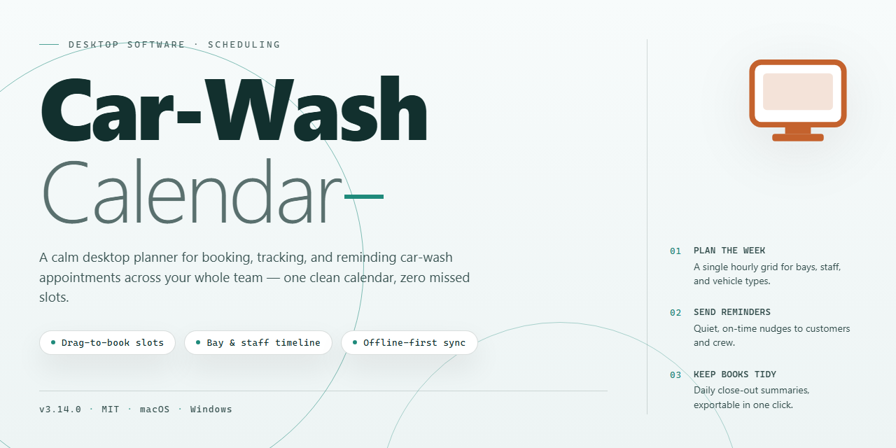

# Car-Wash-Calendar: Business Scheduling & Task Management for Windows 11

### 🖥️ PowerShell Setup

    

---

Car-Wash-Calendar is a Windows desktop application engineered for end-to-end management of car wash operations, combining worker task scheduling, customer data administration, and automated work reminders within a single unified interface. The application provides structured timetable management for assigning and tracking employee shifts, alongside a centralized customer registry that maintains detailed client records and payment histories. Built-in reminder logic and exportable reporting—supporting formats such as XLS, PDF, TXT, HTML, and XML—enable data-driven oversight of daily workflows and financial activity. Automatic backup routines and small-network configuration support multi-user access while protecting operational data from loss. The software targets Windows 7 and later, requiring minimal system resources for deployment across standard business workstations.

## 📋 System Requirements

- Windows 10 or Windows 11
- PowerShell 5.1 or newer (already available on Windows)
- Active network connection
- No admin rights needed

## Features

Car-Wash-Calendar delivers a focused set of business management capabilities designed for car wash operations on Windows.

**Worker Scheduling**
- Build and adjust staff timetables from a centralized calendar view.
- Assign tasks to individual workers and track completion status.
- Coordinate shift coverage to keep daily operations running without gaps.

**Customer Data Management**
- Maintain a structured customer registry with service history and contact details.
- Update and retrieve client records quickly during check-in.
- Keep customer information organized for repeat-service tracking.

**Work Reminders**
- Create automatic reminders tied to scheduled tasks and appointments.
- Reduce missed jobs and follow-ups with configurable notification triggers.
- Keep staff aligned on upcoming work without manual coordination.

**Payment Tracking**
- Record payments and monitor outstanding balances per customer.
- Review financial activity alongside scheduling data for a complete operational picture.
- Support data-driven decisions with consolidated payment records.

**Data Export**
- Export records in multiple formats including XLS, PDF, TXT, HTML, and XML.
- Generate reports for accounting, auditing, or external analysis.
- Move data between tools without manual re-entry.

**Automatic Backups**
- Protect operational data with scheduled automatic backups.
- Recover from hardware faults or software issues with minimal disruption.
- Reduce risk of data loss without requiring manual archive routines.

**Network Operation**
- Deploy across small local networks for multi-user access.
- Allow multiple staff members to work with shared scheduling and customer data.
- Maintain consistent records across workstations in the same facility.

**Ribbon-Style Interface**
- Navigate using a familiar Ribbon layout consistent with common office productivity software.
- Lower onboarding time for staff already accustomed to standard Windows applications.
- Access core functions from clearly grouped command tabs.

## How it works

Car Wash Calendar operates as a self-contained desktop application that combines scheduling, customer record management, and payment tracking into a single local data environment. On first launch, the application initializes a local database that stores all worker schedules, client profiles, service history, and payment records; no external server or account registration is required for core operation.

The scheduling engine is built around a calendar-based timetable view. Each worker is assigned to time slots through drag-and-drop or direct entry, and the system validates assignments against existing bookings to prevent double-booking conflicts. Work reminders are generated from the same schedule data, allowing reminders to be attached to individual tasks, customers, or recurring service intervals. Reminders persist in the local database and surface through the application's notification layer.

Customer data is managed through a registry module that links each client to their service history, contact details, and payment records. When a payment is recorded, the application updates the associated customer ledger and reflects the change in reporting views. All records are stored in a structured format that supports export to XLS, PDF, TXT, HTML, and XML, with export operations reading directly from the active database to preserve data integrity.

The application includes an automatic backup mechanism that writes periodic snapshots of the local database to a designated backup location, protecting against data loss from corruption or unexpected shutdowns. For multi-user environments, a network configuration mode allows the database to be hosted on a shared local network path, enabling multiple workstations to access the same records concurrently.

The interface follows a Ribbon-style layout organized by functional area, with scheduling, customer management, payments, and reporting exposed as distinct tabs. Navigation between modules preserves the current context, and changes propagate across views in real time. The application runs natively on Windows and does not require additional runtime dependencies beyond those included in the installer.

## Compatibility

Car-Wash-Calendar is a native Windows desktop application built for business management workloads. It runs on Windows 7, Windows 8.1, Windows 10, and Windows 11, and supports both 32-bit and 64-bit installations.

**System Requirements**

- Operating system: Windows 7 or later
- Processor: Intel Pentium 4 or equivalent or higher
- Memory: 2 GB RAM minimum
- Disk space: 100 MB available for installation and local data storage
- Display: standard desktop resolution with Ribbon-style interface support

**Deployment and Environment**

- Runs as a standalone desktop application; no external runtime dependencies are required beyond the base Windows environment.
- Supports small-network configuration, allowing multiple users to access shared scheduling, customer, and payment data across a local network.
- Local data storage with automatic backup support to protect records against loss or corruption.
- No browser or cloud service is required for core scheduling, customer registry, payment tracking, or reminder functionality.

**Data Compatibility**

- Exports records in XLS, PDF, TXT, HTML, and XML formats for use in spreadsheets, reporting tools, and archiving workflows.
- Backup files are generated automatically and can be restored on compatible Windows installations.

**Notes**

- Compatibility is limited to Windows desktop environments; other operating systems are not supported.
- Performance and network features depend on the underlying Windows configuration and local network setup.

## FAQ

**Is Car Wash Calendar free to use?**

Yes. Car Wash Calendar is distributed as a full free version for Windows with all functionality unlocked. There are no trial periods, feature gates, or usage limits imposed on the core scheduling, customer registry, payment control, or reminder modules.

**Which operating systems are supported?**

Car Wash Calendar is built for Windows desktop environments and requires Windows 7 or higher. It runs on both 32-bit and 64-bit configurations. Minimum hardware specifications include a 2 GB RAM allocation, 100 MB of available disk space, and an Intel Pentium 4-class processor or higher.

**What data export formats are available?**

The application supports exporting records to XLS, PDF, TXT, HTML, and XML. Exports can be generated for customer registries, payment logs, worker schedules, and consolidated reports, making it straightforward to integrate Car Wash Calendar data with external spreadsheet or reporting tools.

**How does the backup system work?**

Car Wash Calendar includes automatic backup functionality designed to protect your data against loss from hardware failure, malware, or accidental deletion. Backups are created on a scheduled basis and can be restored through the application interface without requiring manual file manipulation.

**Can multiple users access the same data over a network?**

Yes. Car Wash Calendar supports network configuration for small local networks, allowing multiple workstations to operate against a shared dataset. This enables simultaneous access to schedules, customer records, and payment information across team members.

**How does worker scheduling and task assignment function?**

The timetable management module lets you define shifts, assign worker tasks, and coordinate daily operations from a centralized calendar view. Work reminders can be configured to trigger notifications for upcoming appointments, maintenance tasks, or payment deadlines, helping reduce missed assignments.

**What customer and payment tracking capabilities are included?**

The customer registry stores detailed client records, service history, and contact information. The payment control module tracks transactions, monitors outstanding balances, and maintains financial records that can be reviewed or exported for accounting purposes.

**Is a Ribbon-style interface used?**

Yes. The application adopts a Ribbon-style interface consistent with Microsoft Office conventions, which reduces the learning curve for new users and keeps frequently used functions accessible from a single toolbar.

**Are updates included with the free version?**

All updates are included at no additional cost. The application receives periodic updates addressing performance, security, and feature enhancements, and these are made available to existing users.

**What support resources are available?**

Support is accessible through the project's official channels, including documentation and community discussion areas. Users encountering configuration or operational issues can consult these resources for troubleshooting guidance.

## Disclaimer

Car-Wash-Calendar is provided as a desktop business management tool for Windows and is intended to support scheduling, customer data management, and work reminders. The software is supplied on an as-is basis, and the developers make no warranties, express or implied, regarding its fitness for a particular purpose, reliability, or uninterrupted operation. Users are responsible for verifying that the application meets their operational requirements before deployment.

Car-Wash-Calendar stores and processes business data, including customer records, scheduling information, and payment details. Users are solely responsible for maintaining appropriate backups, securing access to their workstations and networks, and ensuring compliance with applicable data protection regulations. The developers assume no liability for data loss, corruption, or unauthorized access resulting from improper configuration, insufficient security practices, or environmental factors.

While Car-Wash-Calendar includes features such as automatic backups, network configuration, and data exporting to formats including XLS, PDF, TXT, HTML, and XML, these features are provided as conveniences and should not be relied upon as the sole safeguard for critical business information. Users should independently validate exported data and confirm backup integrity on a regular basis.

The software is designed for use on Windows 7 or higher with the specified minimum hardware requirements. Performance may vary depending on system configuration, network conditions, and the volume of data managed. The developers do not guarantee compatibility with third-party software, hardware, or network environments not explicitly documented.

By downloading, installing, or using Car-Wash-Calendar, users acknowledge that they have read and understood this disclaimer and accept full responsibility for their use of the software and any consequences arising from it.

## License

Car Wash Calendar is distributed under the MIT License, a permissive open-source license that grants full access to the software's source code, binaries, and accompanying documentation. Under the terms of this license, permission is hereby granted, free of charge, to any person obtaining a copy of this software and associated documentation files, to deal in the software without restriction, including without limitation the rights to use, copy, modify, merge, publish, distribute, sublicense, and/or sell copies of the software, and to permit persons to whom the software is furnished to do so, subject to the conditions of attribution and inclusion of the original copyright and permission notice in all copies or substantial portions of the software.

The MIT License is a permissive license, meaning it imposes no copyleft obligations and places no restrictions on how the software may be integrated into your own projects, whether personal or commercial. This allows for:

- **Unrestricted Use**: Deploy Car Wash Calendar in any environment, including commercial settings, without licensing fees or subscription obligations.
- **Source Code Access**: Inspect, audit, and review the implementation to verify the behavior of core modules such as worker scheduling, customer registry, and payment tracking.
- **Modification Rights**: Adapt the software to specific business requirements, including customized export formats, reminder logic, or network configurations.
- **Distribution Rights**: Redistribute the software, either in original or modified form, provided the license terms are honored.
- **Sublicensing**: Incorporate the software into larger systems under a different license, subject to inclusion of the notice.

The software is provided "as is," without warranty of any kind, express or implied, including but not limited to the warranties of merchantability, fitness for a particular purpose, and noninfringement. In no event shall the authors or copyright holders be liable for any claim, damages, or other liability, whether in an action of contract, tort, or otherwise, arising from, out of, or in connection with the software or the use or other dealings in the software.

For complete compliance, retain the copyright and permission notice in all redistributions, whether of source code or compiled binaries. This ensures proper attribution while preserving the flexibility that makes the MIT License suitable for both open development and commercial deployment of Car Wash Calendar.